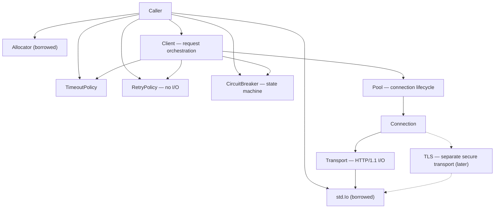
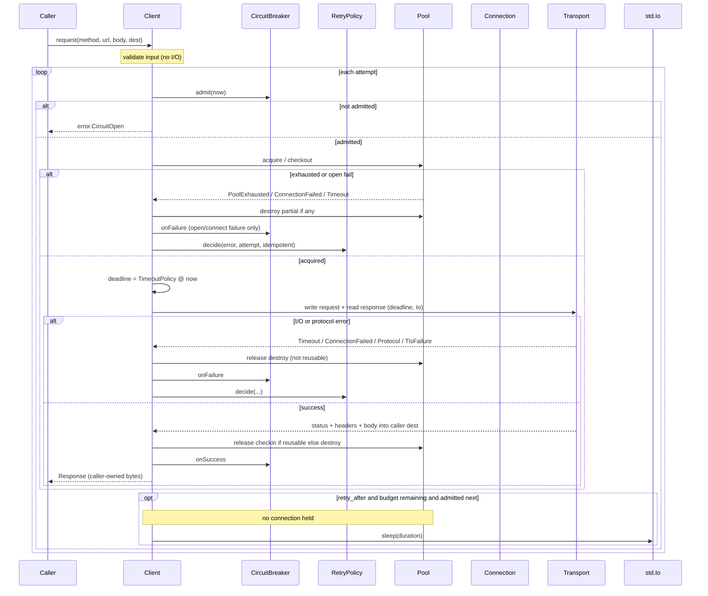

# BKG HTTP Client v1

Status: **LOCKED ARCHITECTURE** — 2026-09-01
Kind: architecture only. No production implementation in this change.
Canonical path: `docs/BKG_HTTP_CLIENT_v1.md` (this file). Do not reintroduce
`docs/BKG_HTTP_OWNERSHIP_v1.md`.
Parent: `libs/bkg-http` remains a stub (`Phase 1+: Implementierung ausstehend`).
Blocked on: CLI/serve baseline landing first
([PR #2](https://github.com/1bitshit/bkg-framework/pull/2), branch `cursor-production-ready-security-3fea`).

This document is the ownership and lifecycle contract for a later `bkg-http`
implementation. It does not ship Client/Pool/Transport/TLS code. Stub files
must not be filled with fake success.

Stub files that stay unimplemented in this PR:

- `libs/bkg-http/src/bkg_http.zig`
- `libs/bkg-http/src/client.zig`
- `libs/bkg-http/src/pool.zig`
- `libs/bkg-http/src/retry.zig`
- `libs/bkg-http/src/circuit_breaker.zig`
- `libs/bkg-http/src/tls.zig`

There is no `transport.zig` stub yet. Transport is specified here and appears
as a type in a later implementation PR.

---

## Decision lock

These decisions are closed. Do not reopen them in implementation PRs.

1. **std only.** HTTP/1.1 client. No third-party HTTP stack.
2. **TLS is a separate transport**, implemented later. A secure client is
   fail-closed. There is **no `http://` fallback** for a secure client.
   TLS can never be silently disabled (no default-off flag, no “best effort”
   cleartext, no env that turns TLS into a no-op).
3. **Blocking via explicit `std.Io`.** No internal thread pool, no async
   runtime, no hidden scheduler. Every I/O call takes the caller-supplied
   `std.Io`. Every allocation takes the caller-supplied `Allocator`.
4. **Timeout is its own policy/transport boundary.** It is not a field of
   `RetryPolicy` and not a field of `CircuitBreaker`. Retry decides *whether*
   and *how long to wait between attempts*. The circuit breaker is a state
   machine. The timeout bounds *this attempt’s I/O*.
5. **No global state.** No process-wide client, pool, or breaker.
6. **No hidden allocations.** If a function allocates, it takes `Allocator`.
7. **No threads in the client.**
8. **No SQLite/PostgreSQL** and **no edits** to frozen DB modules:
   `libs/bkg-db/src/crypto/envelope.zig`, `keyring.zig`,
   `storage/wal_encrypted.zig`, BKG Model Layer.
9. **Pool limit is supplied by the caller** at construction. The library
   never invents a default “unlimited” pool.
10. **Retry only for explicitly retryable errors.** Unknown errors are not
    retryable.
11. **Idempotent retry.** A listed error is not enough. The Client retries
    only when the request is idempotent (safe method, or caller-marked).
    Non-idempotent requests are attempted once.
12. **Circuit breaker `open` is default-deny.** `half_open` allows **one**
    controlled probe request. Other requests while a probe is in flight
    are denied.
13. **Deterministic deinit.** Reverse of init. No leak on error paths.
    Pointers into pool/connection/transport are invalid after the owning
    `deinit`.
14. **Typed errors**, not stringly errors. No `[]const u8` error codes.
15. **All state transitions isolatably testable** without opening sockets.

---

## Component map



| Component | Responsibility | I/O? | Owns sockets? |
|-----------|----------------|------|----------------|
| **Client** | Orchestrate one logical request: breaker → checkout → timeout-bounded attempt → retry decision → checkin | No (delegates) | No |
| **Pool** | Connection ownership and lifecycle; enforce caller-supplied limit | No (delegates open/close) | Indirectly, via Connection |
| **Connection** | One pooled HTTP/1.1 (later TLS) session | No (delegates) | Via Transport |
| **Transport** | HTTP/1.1 bytes on an already-obtained stream | Yes | Yes (`std.Io.net.Stream` or equivalent) |
| **TLS** | Secure transport wrapping a stream. Not implemented now. Separate type, never a boolean on Transport | Yes (later) | No (wraps a stream owned by Connection) |
| **RetryPolicy** | Retry *decision* + backoff *duration*. **No I/O, no sleep** | No | No |
| **CircuitBreaker** | State machine: `closed` / `open` / `half_open` | No | No |
| **TimeoutPolicy** | Time limits for connect / request / total attempt | No (applied at Transport/Io boundary) | No |
| **Allocator** | Explicit memory. Caller owns. | No | No |
| **std.Io** | Explicit I/O context. Caller owns. Must outlive in-flight requests. | — | — |

---

## Ownership matrix (summary)

Field names below are the locked *shape*. Implementation may rename fields
if ownership, lifetime, and deinit order stay identical.

| Component | Who owns | Who mutates | Who destroys | Allowed refs | Forbidden refs |
|-----------|----------|-------------|--------------|--------------|----------------|
| **Client** | Caller | Caller (init/deinit); `request` mutates owned Pool and borrowed CircuitBreaker | Caller via `Client.deinit` | Caller holds `*Client` | No global `Client`. Pool is not shared across Client values |
| **Pool** | Client (owned value) | Client via checkout/checkin/open/destroy | `Client.deinit` → `Pool.deinit` | Client only | Application code must not hold `*Pool` independently of Client |
| **Connection** | Pool | Pool (idle list); Client (one checked-out attempt); Transport I/O mutates buffers | Pool (deinit, non-reusable, open failure) | Pool (idle) or Client (checked-out stack frame) | Application never stores `*Connection` |
| **Transport** | Connection | Connection/Transport during one attempt | `Connection.deinit` → `Transport.deinit` | Owning Connection only | No escape of stream or `read_buf` slices past checkin/deinit |
| **RetryPolicy** | Caller | **Nobody in the library.** Immutable for the Client lifetime | Caller, after `Client.deinit` if heap | Caller + Client `*const RetryPolicy` | Client must not take a mutable pointer |
| **CircuitBreaker** | Caller | Client via `admit` / `onSuccess` / `onFailure` | Caller, after `Client.deinit` if heap | Caller + Client `*CircuitBreaker` | No host→breaker map inside the library |
| **TimeoutPolicy** | Caller | **Nobody in the library.** Immutable | None (value type) | Caller + Client `*const TimeoutPolicy` | Client must not mutate durations mid-request |

---

## Threading and I/O model

The client is **blocking and single-threaded from its own point of view**.

| Rule | Detail |
|------|--------|
| Blocking | Every network and sleep wait uses the caller-supplied `std.Io` and blocks that call |
| No internal threads | `bkg-http` must not spawn threads, start a thread pool, or detach work |
| No async runtime | No event loop, no hidden scheduler, no `async` frame owned by the library |
| Caller concurrency | If the caller uses one Client from multiple threads, that is **unsupported** unless a later PR adds an explicit lock owned by the caller. v1: one in-flight `request` per Client |
| Cancellation | Cooperative via `std.Io` / `Cancelled`. No cancellation thread |
| Sleep on retry | Client waits through `std.Io` after `RetryPolicy` returns a duration. RetryPolicy itself does not sleep |
| Time | Client reads the Io clock at the start of each attempt and passes a deadline into Transport. Policies do not call Io |

`RetryPolicy`, `CircuitBreaker`, and `TimeoutPolicy` are CPU-only. They must
remain safely callable from tests without Io.

---

## Frozen module boundary

`bkg-http` is a separate library. Implementation (when it happens) must not
import, link, or edit:

| Frozen module | SHA256 (from `docs/next-tasks.md`) |
|---------------|-------------------------------------|
| `libs/bkg-db/src/crypto/envelope.zig` | `081af87ff0ab1dad35bb84a964e22f7a282135e79bdce61b51d102c45d276ca4` |
| `libs/bkg-db/src/crypto/keyring.zig` | `695061c684ba61fc13a5747321dd2b4a2b8385a40f188459d0196efdaef57578` |
| `libs/bkg-db/src/storage/wal_encrypted.zig` | `b312512ac96886e8a55a6e3f8ab4f0e8f2df59d07008beb80aa71894d958ff38` |
| BKG Model Layer (`libs/bkg-model/**`) | PROVEN & FROZEN — 2026-09-01 |

Also forbidden: SQLite, PostgreSQL, vault key material, WAL keys, and any
path that would “reuse” envelope crypto for TLS. TLS (later) is a distinct
transport with caller-supplied trust material, not `bkg-db` crypto.

This architecture PR does not touch those files.

---

## No global state

| Forbidden | Required instead |
|-----------|------------------|
| Process-wide `Client`, `Pool`, or `CircuitBreaker` | Caller constructs and owns each instance |
| `host → breaker` or `host → pool` maps inside the library | Caller binds one breaker (and one Client/Pool) per upstream if it wants isolation |
| Thread-local allocator, Io, or RNG | Caller passes Allocator, Io, and any entropy |
| Environment variables that change TLS, pool size, or retry | Construction arguments |
| `std.heap.page_allocator` / GPA created inside the library | Caller Allocator |
| Hidden file descriptors or at-exit hooks | Deterministic `deinit` |

Two Client values never share a Pool. A Pool is not interned by hostname.

---

## Allocator and `std.Io`

Neither is owned by `bkg-http`.

| | Allocator | `std.Io` |
|--|-----------|----------|
| Who allocates/creates | Caller | Caller |
| Who frees/deinits | Caller | Caller |
| Who may hold a copy | Client, Pool, Connection, Transport may store the value/handle they were given | Same |
| Lifetime | Must outlive Client and any in-flight request buffers | Must outlive any blocking call |
| What is NOT owned | The library does not create a GPA, arena, or thread-local allocator | The library does not create a runtime, event loop, or thread pool |

Request-scoped buffers (serialized headers, body copies) are allocated with
the caller Allocator inside Client or Transport and freed on all return
paths (`defer` / `errdefer`) before the call returns. Pool slots are
allocated at `Pool.init` and freed in `Pool.deinit`.

### Global allocator rules

1. If a function allocates, it takes `Allocator` (or uses one stored from
   `init`, which came from the caller).
2. `RetryPolicy.decide`, `CircuitBreaker.admit` / `onSuccess` / `onFailure`,
   and TimeoutPolicy deadline math **must not allocate**.
3. No allocation in `deinit` except freeing previously owned blocks.
4. Response bytes the caller keeps after `request` returns live in
   **caller-owned** memory (caller buffer or an allocation the caller is
   documented to free). Transport `read_buf` aliases are invalid after
   release.
5. Failed allocations surface as Zig allocator errors / `error.OutOfMemory`
   (or the typed set’s equivalent). They are **not retryable**. Release any
   checked-out connection first.

---

## Composition order (one logical request)

The client does not nest timeout inside retry inside the breaker.
Each boundary is applied in this order:

1. **CircuitBreaker** — if `open`, return `error.CircuitOpen` (default-deny).
   If `half_open`, admit **one** probe; additional callers get `error.CircuitOpen`
   until the probe completes.
2. **Pool** — check out a `Connection` (or open one under the limit).
   Exhaustion is `error.PoolExhausted` (not retryable unless the policy
   explicitly lists it; default: not retryable).
3. **TimeoutPolicy** — compute the deadline for *this attempt*.
   Pass it into Transport. Transport must fail with `error.Timeout` when
   the deadline is reached. Retry and breaker never start their own timers.
4. **Transport** (and later TLS) — perform HTTP/1.1 I/O.
5. **RetryPolicy** — given the typed error (or success), return
   `do_not_retry` or `retry_after(duration)` **only if the request is
   idempotent**. The **Client** waits using `std.Io` if a wait is required.
   RetryPolicy itself does not sleep.
6. **CircuitBreaker** — record success/failure. Probe completion in
   `half_open` is the only transition to `closed` (success) or `open` (failure).
7. **Pool** — check in or destroy the connection (destroy on protocol
   desync, TLS failure, or peer close).

A later TLS transport is inserted between Connection and the byte stream.
HTTP/1.1 Transport then reads/writes the TLS stream, not a raw TCP stream.
Cleartext is a different Connection mode, never a silent downgrade of a
secure client.

**Release before wait:** the connection from attempt N is checked in or
destroyed **before** any retry backoff sleep. Attempts never hold a
connection across `retry_after`.

**Breaker on every attempt:** `admit` runs at the start of each attempt,
not only the first. A failed `half_open` probe opens the circuit; leftover
retry budget cannot punch through `open`.

---

## Request lifecycle: request → acquire → transport → response → release

One `Client.request` is one **logical request** and zero or more **attempts**.



### Step contracts

| Step | Owner of action | Mutates | Allocations | Must hold | Must not hold |
|------|-----------------|---------|-------------|-----------|---------------|
| **request** (entry) | Client | nothing yet | none for validation | `*Client`, policies, Allocator, Io | Connection, Transport |
| **admit** | CircuitBreaker via Client | `probe_in_flight` if half_open probe | **forbidden** | `*CircuitBreaker` | Connection |
| **acquire** | Pool via Client | idle/in_use, may open Connection+Transport | Pool may allocate only if slot storage was not preallocated; open may allocate Transport buffers | checked-out `*Connection` on success | Connection across a previous retry sleep |
| **timeout bind** | Client | none (computes deadline value) | **forbidden** | TimeoutPolicy (const) | — |
| **transport** | Transport via Connection | stream, read/write buffers | request-scoped copies with caller Allocator; freed before return from the attempt | Connection + deadline + Io | RetryPolicy, CircuitBreaker |
| **response copy** | Client | caller dest buffer | into **caller-owned** dest only | dest outlives return | `read_buf` alias after release |
| **release** | Pool via Client | idle/in_use, `reusable` | none (destroy frees Transport buffers) | — | `*Connection` after this step |
| **retry decide** | RetryPolicy via Client | none | **forbidden** | `*const RetryPolicy` | Connection (already released) |
| **retry wait** | Client via Io | none | **forbidden** | Io | Connection, Transport |

### Error paths (every exit)

On **every** path, if a connection was acquired, it is released (checkin or
destroy) before `request` returns or before retry sleep. No connection
remains checked out after `Client.request` returns.

| # | Failure point | Error | Release | CB | Retry? |
|---|----------------|-------|---------|----|--------|
| E1 | Bad URL/method/header/scheme | `InvalidInput` | n/a (no acquire) | no record | no |
| E2 | Secure client + `http://` or TLS missing | `TlsRequired` / `NotImplemented` | n/a | no record | no |
| E3 | `admit == false` (`open`, or `half_open` + probe in flight) | `CircuitOpen` | n/a | no additional record | no (`CircuitOpen` not retryable) |
| E4 | `Pool.checkout` at limit | `PoolExhausted` | n/a | **no** (caller-chosen limit, not upstream failure) | no by default |
| E5 | Connect/open fails | `ConnectionFailed` / `Timeout` | destroy partial | `onFailure` | only if idempotent **and** error listed |
| E6 | Connect deadline | `Timeout` | destroy partial | `onFailure` | only if idempotent **and** listed |
| E7 | Write/read deadline | `Timeout` | destroy (not reusable) | `onFailure` | only if idempotent **and** listed |
| E8 | Hang-up / connect reset mid-request | `ConnectionFailed` | destroy | `onFailure` | only if idempotent **and** listed |
| E9 | HTTP/1.1 parse, oversize headers, bad framing | `Protocol` | destroy | `onFailure` | no by default |
| E10 | TLS handshake/verify (later) | `TlsFailure` | destroy | `onFailure` | no by default; never cleartext fallback |
| E11 | Io cancel | `Cancelled` | destroy or checkin per stream state; prefer destroy | `onFailure` if an attempt was in flight | no |
| E12 | Allocator failure | `OutOfMemory` (or equivalent) | release if acquired | no CB record for OOM | no |
| E13 | RetryPolicy says stop after attempts | `RetryBudgetExceeded` (or original error — see RetryPolicy) | already released | already recorded per attempt | no |
| E14 | Sleep interrupted | `Cancelled` | n/a (already released) | no extra record | no |
| E15 | Next attempt `admit == false` after probe failure | `CircuitOpen` | n/a | probe already moved breaker to `open` | no |
| E16 | Transport success | — | checkin if `reusable`, else destroy | `onSuccess` | no (done) |
| E17 | `Client.deinit` while checked out | debug assert or destroy remaining | destroy all | n/a | n/a |

Success path: E16 only. Caller receives a Response whose bytes are independent
of Pool buffers.

---

## Error set (typed)

Implementation must use a Zig error set (name illustrative). It must not
encode failures as strings.

```zig
pub const Error = error{
    InvalidInput,
    Timeout,
    ConnectionFailed,
    TlsRequired,
    TlsFailure,
    Protocol,
    RetryBudgetExceeded,
    CircuitOpen,
    PoolExhausted,
    Cancelled,
    NotImplemented,
};
```

| Error | Typical source | Retryable by default | Notes |
|-------|----------------|----------------------|-------|
| `InvalidInput` | Client (bad URL, header, method) | no | Fail closed before I/O |
| `Timeout` | Transport observing TimeoutPolicy | **yes, only if RetryPolicy lists it** | Produced at the timeout boundary, not by RetryPolicy |
| `ConnectionFailed` | Pool/Connection/Transport open | **yes, only if listed** | |
| `TlsRequired` | Secure client given `http://` or missing TLS | no | Never fall back to cleartext |
| `TlsFailure` | TLS transport | no (unless explicitly listed later) | Fail closed |
| `Protocol` | HTTP/1.1 parse / unexpected status handling | no | |
| `RetryBudgetExceeded` | Client after RetryPolicy says stop | no | |
| `CircuitOpen` | CircuitBreaker | no | Default-deny |
| `PoolExhausted` | Pool | no | Caller chose the limit |
| `Cancelled` | Caller via Io/cancel | no | |
| `NotImplemented` | TLS (until a TLS PR) | no | Secure client cannot pretend success |

**Rule:** an error is retryable only when `RetryPolicy` has an explicit
allow-list entry for that error. Missing from the list means do not retry.

**Rule:** a retryable error is still not retried unless the request is
idempotent (next section).

---

## Idempotent retry

Retry is a **Client** concern. RetryPolicy answers “is this error listed,
and how long to wait?”. It does not know HTTP methods. Client combines
that answer with idempotency.

A logical request is **idempotent** when either:

1. The method is in the safe/idempotent set: `GET`, `HEAD`, `PUT`, `DELETE`,
   `OPTIONS`; or
2. The caller sets an explicit `idempotent: true` mark on the request
   (for a replay-safe `POST` with an application idempotency key, etc.).

Otherwise the request is **non-idempotent** (`POST` / `PATCH` / unknown
method without the mark). Non-idempotent requests get **exactly one**
Transport attempt. RetryPolicy is not consulted to start attempt 2.

Additional locks:

- Request body and headers must remain readable for every attempt. The
  library must not consume a one-shot reader. Caller owns the body for
  the whole `request` call.
- Retrying a listed error on a non-idempotent request is forbidden even
  if the caller configured `Timeout` as retryable.
- HTTP status codes are not a RetryPolicy input in v1 unless a later PR
  adds a typed status-class error. Transport-level failures only, plus
  the explicit error set.
- Redirects are out of scope (no follow-and-retry of `POST` as `GET`).
- `half_open` probe = **one** Transport attempt. If it fails, the breaker
  goes `open`. Client must not treat leftover retry budget as a second
  probe.

Default RetryPolicy: empty allow-list (never retry) is valid and fail-closed.

---

# Ownership by component

---

## Client

Request orchestration only. Does not speak HTTP bytes. Does not own sockets.

### Struct field ownership

| Field | Type (shape) | Who allocates | Who frees |
|-------|----------------|---------------|-----------|
| `allocator` | `std.mem.Allocator` | Caller | Caller |
| `io` | `std.Io` | Caller | Caller |
| `pool` | `Pool` (owned value) | Client.init | Client.deinit → Pool.deinit |
| `retry` | `*const RetryPolicy` | Caller | Caller |
| `breaker` | `*CircuitBreaker` | Caller | Caller |
| `timeout` | `*const TimeoutPolicy` | Caller | Caller |
| `secure` | `bool` (construction-time) | — | — |

A **secure client** is constructed by a distinct initializer (e.g.
`Client.initSecure`). That path requires TLS once TLS exists; until then it
returns `error.NotImplemented` or `error.TlsRequired`. It must not accept
`http://` URLs and must not have a `insecure: true` default.

A **cleartext client**, if it exists at all, is a distinct initializer that
only accepts `http://` and cannot be “upgraded” into a secure client by
toggling a flag. No single constructor takes an optional TLS setting that
defaults to off.

Client owns **one** Pool. Pools are not shared across Client values and are
not stored globally.

### Who mutates

| Target | Mutator | When |
|--------|---------|------|
| Owned `Pool` | Client | acquire / release / deinit |
| Borrowed `CircuitBreaker` | Client | `admit`, `onSuccess`, `onFailure` |
| `RetryPolicy` | **never** | — |
| `TimeoutPolicy` | **never** | — |
| Caller request/response buffers | Client may write into the documented dest | during response copy; not after return |

### Allowed refs / lifetimes

- Caller holds `*Client` for the Client lifetime.
- Pointers returned from Pool checkout are valid only until checkin/destroy
  or `Client.deinit`.
- Client must not retain pointers to request URLs, headers, or bodies after
  the orchestrating function returns (it may copy into Allocator-backed
  buffers that it frees before return).
- `retry`, `breaker`, `timeout` pointers must remain valid for every
  `request` call.
- One in-flight `request` per Client (v1).

### Allowed / forbidden allocations

| Allowed | Forbidden |
|---------|-----------|
| Request-scoped header/body serialization via caller Allocator, freed before return | GPA / arena owned by Client |
| Response copy into caller dest (caller-owned) | Retaining Transport `read_buf` slices after release |
| Delegating slot allocation to Pool.init | Thread-local buffers |
| | Allocating during deinit except frees |

### Error paths

| Error | Who returns it |
|-------|----------------|
| `InvalidInput` | Client (URL/scheme/method/header validation) |
| `TlsRequired` | Client (secure client + `http://` or TLS missing) |
| `CircuitOpen` | Client after querying CircuitBreaker |
| `PoolExhausted` | Client after Pool.checkout fails |
| `RetryBudgetExceeded` | Client when RetryPolicy returns stop after attempts |
| `Timeout` / `ConnectionFailed` / `Protocol` / `TlsFailure` | Propagated from Transport/TLS after recording them on the breaker |
| `Cancelled` | Propagated from Io |
| `NotImplemented` | Client secure path while TLS is absent |

On any error after checkout: check in or destroy the connection, then
return. No connection may remain checked out after Client.request returns.

### Deinit order

1. Assert no checked-out connections (debug) or destroy them (fail closed).
2. `pool.deinit(allocator, io)`
3. Do **not** deinit retry / breaker / timeout / allocator / io.

### What is NOT owned

RetryPolicy, CircuitBreaker, TimeoutPolicy, Allocator, std.Io, caller
request/response buffers, TLS configuration secrets (when those exist).

---

## Pool

Owns connection slots. Enforces the caller-supplied limit. Does not parse HTTP.

### Struct field ownership

| Field | Type (shape) | Who allocates | Who frees |
|-------|----------------|---------------|-----------|
| `allocator` | `std.mem.Allocator` | Caller (stored) | Caller |
| `io` | `std.Io` | Caller (stored) | Caller |
| `limit` | `usize` | Caller argument; **required, ≥ 1** | — |
| `idle` | list/array of `*Connection` | Pool | Pool.deinit |
| `in_use` | count or generation set | Pool | Pool.deinit |
| `slots` | preallocated `[limit]Connection` or equivalent | Pool.init | Pool.deinit |

There is no default limit. `Pool.init` without a positive limit is
`error.InvalidInput`. The library must not substitute `maxInt(usize)`,
`0` meaning unlimited, or an env-derived size.

### Who mutates

| Target | Mutator | When |
|--------|---------|------|
| `idle` / `in_use` / slot generation | Pool | checkout, checkin, destroy, deinit |
| `limit` | **never after init** | — |
| Connection `reusable` | Connection/Client via Pool release | on protocol/TLS/peer-close |

### Allowed refs / lifetimes

- Only Pool and the Client that owns it may hold `*Connection`.
- A checked-out `*Connection` may be used by the current `Client.request`
  stack frame only.
- After checkin, the pointer must not be used.
- After `Pool.deinit`, all connection and transport pointers are invalid.

### Allowed / forbidden allocations

| Allowed | Forbidden |
|---------|-----------|
| Slot storage at `init` (size = caller `limit`) | Growing past `limit` |
| Transport buffers when opening a connection (via Connection) | Per-checkout heap growth that bypasses the limit |
| | Default “unlimited” backing store |
| | Allocating a new Pool globally per host |

### Error paths

| Error | Who returns it |
|-------|----------------|
| `InvalidInput` | Pool.init (limit 0) |
| `PoolExhausted` | checkout when `in_use == limit` and no idle reusable connection |
| `ConnectionFailed` | checkout when opening a new connection fails |
| `Timeout` | checkout when connect exceeds TimeoutPolicy (deadline passed in by Client) |

Open/close of the underlying stream is performed through Connection/Transport
using the stored Io. Pool itself does not call sockets except via Connection.

### Deinit order

1. For each in-use connection: treat as abandoned, `Connection.deinit`
   (close transport).
2. For each idle connection: `Connection.deinit`.
3. Free slot storage with Allocator.
4. Do not deinit Allocator or Io.

Deterministic: two `deinit` calls are forbidden (debug assert) or the second
is a no-op after zeroing. Prefer one-shot deinit with a debug “deinited” flag.

### What is NOT owned

Hostnames, URLs, request bodies, RetryPolicy, CircuitBreaker, TimeoutPolicy
values (deadlines are arguments to checkout/open), TLS cert store (later,
owned by caller and borrowed by the TLS transport).

---

## Connection

One pooled session. Idle in the pool or checked out for a single request.

### Struct field ownership

| Field | Type (shape) | Who allocates | Who frees |
|-------|----------------|---------------|-----------|
| `transport` | `Transport` | Connection.open | Connection.deinit |
| `tls` | optional TLS handle, **absent until TLS exists** | Connection.openSecure (later) | Connection.deinit |
| `generation` | integer | Pool | — |
| `reusable` | `bool` | Connection | — |

Connection does not own Allocator/Io storage of its own; it uses the
Pool/Client-provided ones for open/close.

### Who mutates

| Target | Mutator | When |
|--------|---------|------|
| `transport` buffers/stream | Transport during the checked-out attempt | I/O |
| `reusable` | Connection/Client | after Protocol/TlsFailure/peer-close → `false` |
| `generation` | Pool | checkout/checkin to invalidate stale pointers |
| TLS handle (later) | Connection.openSecure / deinit | — |

### Allowed refs / lifetimes

- Pool holds idle connections.
- Client holds a checked-out pointer for the duration of one attempt.
- Transport internals (read buffers, the stream) must not escape Connection.
- Application code never stores `*Connection`.

### Allowed / forbidden allocations

| Allowed | Forbidden |
|---------|-----------|
| Transport (and later TLS) buffers via caller Allocator at open | Per-request unbounded buffer growth without a documented cap |
| | Owning a duplicate Allocator/Io |
| | Global connection table |

### Error paths

| Error | Who returns it |
|-------|----------------|
| `ConnectionFailed` | open |
| `Timeout` | open, if connect deadline fires |
| `TlsRequired` / `TlsFailure` / `NotImplemented` | openSecure |
| `Protocol` | surfaced from Transport during a request; Connection marks `reusable = false` |

A connection that returns `Protocol`, `TlsFailure`, or peer-close is not
returned to the idle list; it is deinited.

### Deinit order

1. If TLS handle present (later): `tls.deinit` then drop the inner stream
   only if TLS does not own closing it — **one close**.
2. `transport.deinit` (closes stream if still open).
3. Zero secret material if any (TLS session tickets later).

Until TLS exists, deinit is Transport.deinit only.

### What is NOT owned

Pool, Client, policies, caller buffers, global DNS state (none allowed).

---

## Transport

HTTP/1.1 I/O on a stream. Blocking through `std.Io`. No retries. No breaker.
No “wait up to N then retry” logic.

### Struct field ownership

| Field | Type (shape) | Who allocates | Who frees |
|-------|----------------|---------------|-----------|
| `stream` | `std.Io.net.Stream` (or equivalent) | Transport.connect | Transport.deinit |
| `read_buf` | slice from Allocator **or** caller-provided buffer | documented at init | matching free |
| `write_buf` | same | same | same |
| `io` | `std.Io` | Caller (stored) | Caller |

If buffers are heap-allocated, Transport.deinit frees them. If they are
caller-provided, Transport does not free them (document which mode a given
init uses; do not mix silently).

### Who mutates

| Target | Mutator | When |
|--------|---------|------|
| `stream` | Transport | connect, read, write, close |
| `read_buf` / `write_buf` contents | Transport | one attempt |
| TimeoutPolicy | **never** (receives a deadline value only) | — |
| RetryPolicy / CircuitBreaker | **never** | — |

### Allowed refs / lifetimes

- Connection owns Transport.
- Slices into `read_buf` that alias the last response are invalid after the
  next read, after Connection checkin, and after deinit.
- Client must copy any response data the caller needs to retain, using the
  caller Allocator or caller dest, before checkin.

### Allowed / forbidden allocations

| Allowed | Forbidden |
|---------|-----------|
| Documented read/write buffers | Allocating a retry buffer “in case” |
| Temporary parse scratch freed before return from the call | Calling Allocator without the stored/passed allocator |
| | Creating Io, threads, or timers of its own |

### Error paths

| Error | Who returns it |
|-------|----------------|
| `Timeout` | any I/O that observes the attempt deadline from TimeoutPolicy |
| `ConnectionFailed` | connect, write, unexpected hang-up |
| `Protocol` | malformed HTTP/1.1, unsupported transfer encoding, oversize headers |
| `Cancelled` | Io cancellation |

Transport must take an explicit deadline (from TimeoutPolicy) on connect and
on the request/response exchange. It must not read TimeoutPolicy itself and
must not call RetryPolicy or CircuitBreaker.

### Deinit order

1. Close `stream` via Io.
2. Free owned buffers.
3. Do not deinit Io/Allocator.

### What is NOT owned

TLS, Pool, retry/breaker/timeout *policies* (only a deadline value per call),
parsed application JSON, caller URL strings after copies are made.

---

## RetryPolicy

Retry decision + backoff duration. **No I/O. No sleep. No sockets. No time
source.**

### Struct field ownership

| Field | Type (shape) | Who allocates | Who frees |
|-------|----------------|---------------|-----------|
| `max_attempts` | `u32` | Caller | — (value type) |
| `retryable` | explicit set of `Error` tags | Caller | Caller if heap; prefer comptime/static |
| `backoff` | pure function `(attempt) → duration` | Caller | — |

RetryPolicy owns no connections and no Allocator by default. If `retryable`
is a heap set, the caller allocates and frees it.

### Who mutates

**Nobody in `bkg-http`.** Client stores `*const RetryPolicy`. Tests may
construct a stack value. `decide` is a pure function of
`(error, attempt_index, policy fields)`.

Idempotency is **not** a RetryPolicy field. Client applies it before
honoring `retry_after`.

### Allowed refs / lifetimes

- Caller owns the policy for process/config lifetime.
- Client stores `*const RetryPolicy`.
- Tests construct a policy on the stack and call `decide` without a Client.
- RetryPolicy must not hold `*Client`, `*Pool`, `*Connection`, or Io.

### Allowed / forbidden allocations

| Allowed | Forbidden |
|---------|-----------|
| Caller-owned heap set for `retryable` (optional) | Allocation inside `decide` |
| | Sleep, clock reads, socket opens |
| | Process-global RNG for jitter |

### Error paths

RetryPolicy **returns a decision**, not an I/O error:

- `stop` — Client then returns the original error, or `RetryBudgetExceeded`
  if attempts were used up.
- `retry_after(duration)` — Client waits using `std.Io`, then starts a new
  **attempt** with a fresh TimeoutPolicy deadline, after **re-admit** on
  the breaker.

RetryPolicy must not return `Timeout` (that is Transport’s job) and must not
open the circuit (that is CircuitBreaker’s job).

Default: empty retryable set (never retry) is valid and fail-closed.

### Deinit order

Value type: none. Heap set: caller frees after Client.deinit.

### What is NOT owned

Io, clocks, sockets, jitter sources that hide global RNG — if jitter is
needed, the Client passes entropy in, or tests pass a deterministic sequence.
No process-global RNG. Timeouts and circuit cooldown are not retry fields.

---

## CircuitBreaker

State machine. **No I/O.** `open` is default-deny. `half_open` allows one
controlled probe.

### Struct field ownership

| Field | Type (shape) | Who allocates | Who frees |
|-------|----------------|---------------|-----------|
| `state` | `enum { closed, open, half_open }` | CircuitBreaker.init | — |
| `probe_in_flight` | `bool` | breaker | — |
| `consecutive_failures` | `u32` | breaker | — |
| `open_until` | timestamp **or** failure-count-only | breaker | — |
| `threshold` | `u32` (caller-supplied) | Caller | — |

Time-based re-open to `half_open` uses a timestamp **supplied by the caller**
(or by Client reading the Io clock and passing `now`). The breaker does not
call Io itself.

### Who mutates

| Field | Mutator | When |
|-------|---------|------|
| `state`, `probe_in_flight`, `consecutive_failures`, `open_until` | Client calling `admit` / `onSuccess` / `onFailure` (or tests) | each attempt |
| `threshold` | **never after init** | — |

The breaker does not mutate Pool, Connection, RetryPolicy, or TimeoutPolicy.

### Allowed refs / lifetimes

- Caller owns `*CircuitBreaker`.
- One breaker per upstream/authority is the caller’s choice; the library
  never keeps a map of host → breaker.
- Tests drive `onSuccess` / `onFailure` / `admit` without Client, Pool, or
  sockets.
- Breaker must not hold connection or Io pointers.

### Allowed / forbidden allocations

| Allowed | Forbidden |
|---------|-----------|
| Optional heap allocation of the breaker struct by the **caller** | Allocation inside `admit` / `onSuccess` / `onFailure` |
| | Per-host tables inside the library |

### State transitions (isolatably testable)

| From | Event | To | Admit request? |
|------|-------|-----|----------------|
| `closed` | success | `closed` | yes |
| `closed` | failure, count < threshold | `closed` | yes |
| `closed` | failure, count ≥ threshold | `open` | subsequent: **no** (`CircuitOpen`) |
| `open` | admit | `open` | **no** (default-deny) |
| `open` | `now >= open_until` (or explicit `allowProbe`) | `half_open` | — |
| `half_open` | admit, no probe in flight | `half_open`, `probe_in_flight=true` | **yes, this one probe** |
| `half_open` | admit, probe in flight | `half_open` | **no** (`CircuitOpen`) |
| `half_open` | probe success | `closed`, clear probe | — |
| `half_open` | probe failure | `open`, clear probe | — |

`admit` is a pure state question plus the single probe flag. It does not
perform I/O.

`open` default-deny: any `admit` while `open` (and not transitioning to
`half_open` first) returns denied. There is no “let a percentage through”.

### Error paths

| Error | Who returns it |
|-------|----------------|
| `CircuitOpen` | Client when `admit` is false |

The breaker itself returns bool/enum from `admit`, not a network error.

### Deinit order

Value/heap owned by caller. If heap-allocated, caller frees after Client.deinit.
No sockets to close.

### What is NOT owned

TimeoutPolicy, RetryPolicy, Pool, connections, Io.

---

## TimeoutPolicy

Time limits for a **single attempt**. Not a retry budget. Not a circuit
cooldown. Not a field of RetryPolicy or CircuitBreaker.

### Struct field ownership

| Field | Type (shape) | Who allocates | Who frees |
|-------|----------------|---------------|-----------|
| `connect` | duration | Caller | — |
| `request` | duration (headers+body write/read) | Caller | — |
| `total_attempt` | duration (optional cap of the two) | Caller | — |

Value type. No I/O. No ownership of clocks.

Client (not RetryPolicy, not CircuitBreaker) converts these durations into a
deadline using `std.Io`’s clock **at the start of each attempt**, then passes
the deadline into Transport. A retry does **not** inherit a spent deadline.

### Who mutates

**Nobody in `bkg-http`.** Client stores `*const TimeoutPolicy`.

### Allowed refs / lifetimes

- Caller owns `*const TimeoutPolicy`.
- Client must not mutate it.
- Tests can compute deadlines with a fake clock without sockets.
- TimeoutPolicy must not hold Transport, Pool, or breaker pointers.

### Allowed / forbidden allocations

| Allowed | Forbidden |
|---------|-----------|
| None in policy methods | Allocation, sleep, socket I/O |
| | Storing a running timer inside RetryPolicy or CircuitBreaker |

### Error paths

TimeoutPolicy does not return errors. Transport returns `error.Timeout`
when the deadline is exceeded. Missing/zero durations are `InvalidInput` at
Client/policy construction (fail closed: a zero timeout is not “infinite”).

Infinite/absent timeouts are forbidden on the production Client path.
Tests may pass large finite values.

### Deinit order

None (value type).

### What is NOT owned

Retry backoff durations, circuit `open_until`, Io, Transport.

---

## TLS (not implemented; ownership locked)

TLS is a **separate transport type**, not a flag on HTTP/1.1 Transport.

| | Rule |
|--|------|
| Ownership | Connection owns the TLS handle; TLS wraps a stream the Connection opened |
| Disable | Impossible on a secure client. No field `tls: ?void = null` that skips handshake |
| `http://` | Secure client returns `TlsRequired`. No cleartext fallback |
| `https://` before TLS exists | Secure client returns `NotImplemented` or `TlsRequired` — never success |
| Errors | `TlsFailure` fail-closed; no “ignore cert” default |
| Frozen modules | TLS must not touch envelope/keyring/wal_encrypted or Model Layer |
| Deinit | TLS shutdown then inner stream close, exactly once |

---

## Deterministic deinit (summary)

```
Client.deinit
  └─ Pool.deinit
       └─ for each Connection (in-use then idle):
            Connection.deinit
              ├─ TLS.deinit          (later; if present)
              └─ Transport.deinit    (closes stream, frees owned buffers)
Caller.deinit CircuitBreaker if heap
Caller.deinit RetryPolicy heap set if any
Caller.deinit Allocator / Io
```

Error paths during `request` run the same Connection cleanup for the
checked-out connection, then return, then the caller still eventually calls
`Client.deinit`.

---

## Test obligations (when implementation happens)

Each of the following must be testable **without** a listening socket:

- CircuitBreaker: every row in the transition table, including
  “second admit in `half_open` is denied”.
- RetryPolicy: empty allow-list never retries; listed `Timeout` retries;
  unlisted `Protocol` does not; backoff durations are deterministic given
  attempt index.
- Idempotency: listed `Timeout` on `POST` without the caller mark does
  **not** retry; same error on `GET` does (when listed).
- TimeoutPolicy: zero duration rejected; deadline is per-attempt (retry
  does not inherit a spent deadline).
- Pool: limit 0 rejected; checkout at limit returns `PoolExhausted`;
  deinit closes remaining connections.
- Client: secure constructor rejects `http://`; does not return success
  while TLS is unimplemented.
- Transport protocol errors mark Connection not reusable.
- Release-before-wait: after a retryable failure, no connection remains
  checked out during backoff (assert via Pool `in_use`).
- Half-open: probe failure → `open` → leftover retry budget does not
  start a second Transport attempt.

Socket tests come later and stay behind the same error set.

---

## Out of scope for this document and for the first implementation PR

- HTTP/2, HTTP/3, proxy CONNECT, cookies, redirects-as-policy
- SSE / WebSocket
- Filling `libs/bkg-http/src/*.zig` in this architecture PR
- Changing frozen DB/crypto/model modules
- Embedding a thread pool or async runtime to “make timeouts easier”
- Multi-threaded use of one Client

Implementation PRs must cite `docs/BKG_HTTP_CLIENT_v1.md` and must not
weaken fail-closed behavior to get a green demo.
